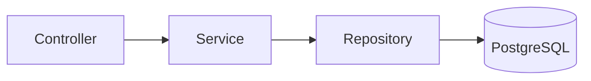

# Stock

[](https://github.com/Felipe-Osorio-Dev/Stock/actions/workflows/ci.yml)

API de gestão de estoque construída com **ASP.NET Core** e **PostgreSQL**, desenvolvida como projeto de portfólio com foco em qualidade: arquitetura em camadas, integração contínua e fluxo de trabalho com branches e Pull Requests.

## Sobre o projeto

O objetivo é construir um sistema de estoque completo, evoluindo em módulos. Cada módulo é desenvolvido em uma branch própria, passa pelo CI e entra na `main` via Pull Request.

**Estado atual:** CRUD de produtos completo, e pipeline de CI.

## Tecnologias

- C# e ASP.NET Core Web API
- Entity Framework Core com PostgreSQL (Npgsql)
- Mapster (mapeamento entre entidades e DTOs)
- GitHub Actions (CI)

## Arquitetura

O projeto segue uma arquitetura em camadas, em que cada uma tem uma única responsabilidade:



| Camada | Responsabilidade |
|---|---|
| **Controller** | Recebe a requisição HTTP e traduz o `Result` do service em resposta HTTP. Não tem regra de negócio. |
| **Service** | Regras de negócio. Devolve `Result<T>`, sem conhecer HTTP. |
| **Repository** | Acesso a dados com EF Core. Não tem regra de negócio. |

### Decisões de projeto

- **`Result<T>` em vez de exceções para erros de negócio:** o service informa o motivo da falha (`Validation`, `NotFound`, `Conflict`) e o controller converte em status HTTP por meio de um único ponto (`ResultExtensions`).
- **Unicidade do SKU garantida pelo banco:** há um índice único em `Sku`. Em vez de checar antes de inserir (o que abre uma condição de corrida), o service tenta gravar e trata a violação de unicidade do PostgreSQL (`SqlState 23505`) como `409 Conflict`.
- **SKU normalizado:** o service remove espaços e converte para maiúsculas, para que `abc-1` e `ABC-1` não virem produtos diferentes.
- **Formato de erro padronizado:** toda resposta de erro, inclusive as de validação, segue o mesmo formato (veja abaixo).
- **Entidades não saem da API:** o service sempre devolve DTOs.

## Como rodar

### Pré-requisitos

- [.NET SDK 8](https://dotnet.microsoft.com/download) ou superior
- [PostgreSQL](https://www.postgresql.org/download/) em execução
- [Docker](https://www.docker.com/products/docker-desktop/) (apenas para os testes de integração)
- Ferramenta do EF Core: `dotnet tool install --global dotnet-ef`

### Passo a passo

1. Clone o repositório:

   ```bash
   git clone https://github.com/Felipe-Osorio-Dev/Stock.git
   cd Stock
   ```

2. Configure a connection string com **User Secrets** (ela não fica no repositório):

   ```bash
   dotnet user-secrets init --project StockAPI
   dotnet user-secrets set "ConnectionStrings:DefaultConnection" "Host=localhost;Port=5432;Database=estoque;Username=postgres;Password=SUA_SENHA" --project StockAPI
   ```

3. Crie o banco aplicando as migrations:

   ```bash
   dotnet ef database update --project StockAPI
   ```

4. Rode a API:

   ```bash
   dotnet run --project StockAPI
   ```

## Endpoints

Base: `/api/products`

| Método | Rota | Descrição | Respostas |
|---|---|---|---|
| `GET` | `/api/products` | Lista produtos com paginação (`page`, `pageSize`) | 200, 400 |
| `GET` | `/api/products/{id}` | Busca um produto | 200, 404 |
| `POST` | `/api/products` | Cria um produto | 201, 400, 409 |
| `PUT` | `/api/products/{id}` | Atualiza um produto | 200, 400, 404, 409 |
| `DELETE` | `/api/products/{id}` | Remove um produto | 204, 404 |

A paginação aceita `pageSize` entre 1 e 100 (padrão: 20).

### Exemplo: criar produto

```http
POST /api/products
Content-Type: application/json

{
  "name": "Teclado Mecânico",
  "sku": "tec-001",
  "description": "Switch azul",
  "price": 199.90,
  "minimumStock": 5
}
```

Resposta `201 Created`:

```json
{
  "id": 1,
  "name": "Teclado Mecânico",
  "sku": "TEC-001",
  "description": "Switch azul",
  "price": 199.90,
  "minimumStock": 5,
  "isActive": true,
  "createdAt": "2026-10-22T10:00:00Z"
}
```

### Formato de erro

Qualquer resposta de erro (validação, não encontrado, conflito) usa o mesmo formato:

```json
{
  "statusCode": 409,
  "message": "Já existe um produto com o SKU 'TEC-001'."
}
```

## Integração contínua

O workflow em `.github/workflows/ci.yml` roda a cada Pull Request e a cada push na `main`: restaura as dependências, compila em Release e executa todos os testes. A `main` é protegida e só recebe alterações por Pull Request com o check `build-and-test` aprovado.

## Fluxo de trabalho

- Uma branch curta por tarefa: `feature/...`, `fix/...`, `chore/...`, `docs/...`
- Commits pequenos, no padrão [Conventional Commits](https://www.conventionalcommits.org/) (`feat:`, `fix:`, `test:`, `chore:`, `docs:`)
- Pull Request com descrição do que mudou, decisões e como testar, integrado por squash merge

## Autor

Felipe Osorio — [GitHub](https://github.com/Felipe-Osorio-Dev)
